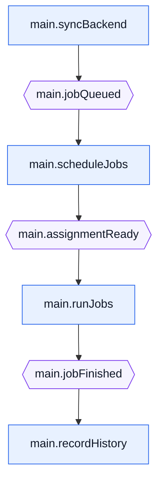

# backplane

[![CI][ci-badge]][ci]
[![Go Reference][reference-badge]][go-reference]
[![License: Apache-2.0][license-badge]][license]

A small in-process application runtime for Go. You write modules as ordinary
functions, and their signatures declare how they plug into the application:
resources they need, topics they publish or subscribe to, and the shared
lifecycle they run under. Backplane wires the modules together, runs them
concurrently, and can render the resulting topology — all from the same
declarations.

## Installation

```console
go get github.com/infin-robotics/backplane
```

```go
type jobQueued struct{ ID string }
type assignmentReady struct{ Job, Printer string }
type jobFinished struct{ Job string }

func syncBackend(ctx context.Context, store *jobStore, queued chan<- jobQueued) error {
	for _, id := range store.Queued() {
		queued <- jobQueued{ID: id}
	}
	return nil
}

func scheduleJobs(ctx context.Context, queued <-chan jobQueued, assignments chan<- assignmentReady) error {
	for job := range queued {
		assignments <- assignmentReady{Job: job.ID, Printer: "printer-1"}
	}
	return nil
}

func runJobs(ctx context.Context, assignments <-chan assignmentReady, finished chan<- jobFinished) error { … }
func recordHistory(ctx context.Context, finished <-chan jobFinished) error { … }

func main() {
	application, err := backplane.New(syncBackend, scheduleJobs, runJobs, recordHistory)
	if err != nil {
		log.Fatal(err)
	}

	// The caller owns resource construction and cleanup.
	store := openJobStore()
	defer store.Close()

	if err := application.Run(context.Background(), store); err != nil {
		log.Fatal(err)
	}
}
```

Each module is directly testable — call it with a context, a fake store, and
channels you control. Registration never executes module code, so the same
declarations also produce a top-to-bottom dataflow without opening a single
connection. Import `github.com/infin-robotics/backplane/mermaid` to render it:

```go
fmt.Print(mermaid.Render(application.Graph()))
```



See the [package documentation][go-reference] for wiring, lifecycle and delivery
contracts, runtime options, and executable examples.

## What backplane is not

- **Not a message broker** — no persistence, cross-process transport, or QoS.
- **Not a resource construction or lifecycle container** — the caller creates
  resources and cleans them up; backplane only binds already-created values.
- **Not a process manager** — the module set is fixed before startup. A module
  that needs dynamic workers spawns and joins its own goroutines.

## Stability

Backplane requires Go 1.25 or later. It is pre-1.0, so its public API may change
while it is validated in production applications.

## Licence

Apache-2.0. See [LICENSE](LICENSE).

[ci]: https://github.com/infin-robotics/backplane/actions/workflows/ci.yml
[ci-badge]: https://github.com/infin-robotics/backplane/actions/workflows/ci.yml/badge.svg
[go-reference]: https://pkg.go.dev/github.com/infin-robotics/backplane
[license]: LICENSE
[license-badge]: https://img.shields.io/badge/license-Apache--2.0-blue.svg
[reference-badge]: https://pkg.go.dev/badge/github.com/infin-robotics/backplane.svg
